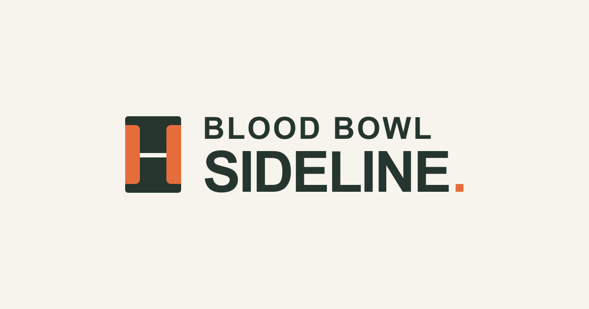

# Blood Bowl Sideline

Build and share Blood Bowl teams, track player development, and run BB2025 leagues. Made for the Ukrainian Blood Bowl community, with English and Ukrainian interfaces.

[Open Sideline](https://sideline.com.ua/) · [Contributing](CONTRIBUTING.md) · [License](LICENSE) · [Attribution](ATTRIBUTION.md)



## What you can do

- Build teams using all 31 BB2025 rosters, with player, star player, skill, and inducement references.
- Check budgets, skills, and eligibility against Default, Matched Play, EuroBowl 2026, and NAF World Cup 2027 v2.1 presets.
- Save guest drafts on your device or sign in through Telegram to save teams to your account.
- Share rosters by link, duplicate teams, and print sheets with skill references.
- Run leagues with round-robin fixtures, shared match reports, coach confirmation, standings, and player progression.

Tournament management is not yet available.

## League play

Sign in through Telegram and create a league. Share its link so coaches can register legal BB2025 starting teams from their accounts. The commissioner launches the season to generate round-robin fixtures.

Both coaches edit and confirm the same match report. Once both confirm, Sideline locks the result and applies standings and player development. Commissioners can correct reports with a recorded reason. Corrections that affect later progression require reconciliation and are currently rejected.

League rosters have their own official state. Editing a team in the exhibition builder does not change its league progression. Coaches can spend earned SPP on chosen skills and manage their post-game sequence. Random skills, characteristic advancements, automatic concession consequences, and season redrafting are not yet supported.

See the [league testing guide](docs/league-testing.md), [match reports](docs/league-event-reporting.md), and [league rules sources](docs/league-rules-sources.md).

## Run locally

Use Node.js 24, the pnpm version pinned in `package.json`, and your own Convex development deployment.

```sh
corepack enable
pnpm install --frozen-lockfile
pnpm dev
```

On the first run, Convex prompts you to configure a development deployment and writes its URLs to `.env.local`. The command then runs Convex and Next.js together. Open [localhost:3000](http://localhost:3000).

Guest team building works without Telegram credentials. See [development and deployment](docs/development.md) for authentication setup, development sign-in, admin access, project layout, and Vercel deployment. [.env.example](.env.example) lists the configuration. Never commit secrets or `.env` files.

The frontend uses Next.js App Router, React, TypeScript, Tailwind CSS, and shadcn/ui. Convex handles authentication and persistence. `next-intl` provides translations. Read [rules sources](docs/rules-sources.md) before changing game data and [backend notes](convex/README.md) before changing persistence.

## Contributing

Opening an issue is a contribution. Bug reports, rules corrections, translation fixes, and suggestions are welcome. Pull requests and forks are welcome too. I maintain Sideline as time allows and do not commit to reviewing or merging pull requests within any particular timeframe. See [CONTRIBUTING.md](CONTRIBUTING.md).

## License and attribution

Copyright © 2026 martinAbsolute. Original project code and documentation use [GNU AGPL-3.0-only](LICENSE). Keep the project's copyright and license notices when distributing copies. Hosted modified versions must provide their corresponding source under the AGPL.

Blood Bowl names, rules, trademarks, and third-party artwork are not covered by the project's license. See [ATTRIBUTION.md](ATTRIBUTION.md) for credits and artwork notes.

Blood Bowl is a trademark of Games Workshop. Sideline is an independent community project, unaffiliated with Games Workshop or FUMBBL.

Created by [martinAbsolute](https://github.com/martinAbsolute/) · [Telegram](https://t.me/martinAbsolute).
